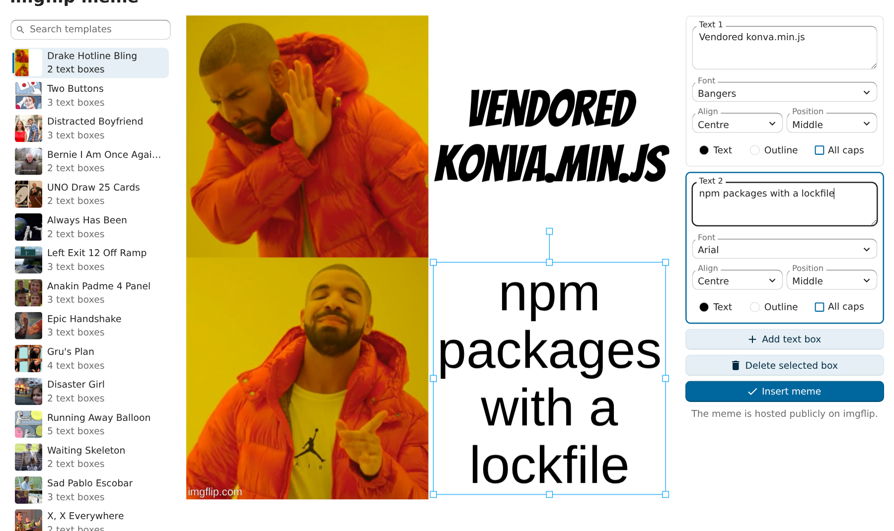

# Caption Obvious

[](https://github.com/meatybot/caption_obvious/actions/workflows/lint.yml)

A Nextcloud ExApp that adds a meme entry to the Smart Picker. Search imgflip's templates, write the
captions, and insert the meme into Text, Talk or any other app with the Smart Picker. The meme is
hosted publicly on imgflip, and imgflip links render as the image, as memegen.link links do with the
memegen app.



## Requirements

- Nextcloud 31 to 36 with AppAPI and a deploy daemon (HaRP recommended).
- **AppAPI with ExApp reference providers.** This is not in a released AppAPI yet: it is proposed in
  [nextcloud/app_api#1099](https://github.com/nextcloud/app_api/issues/1099). With an AppAPI without
  the `/api/v1/ui/reference-provider` endpoint, the app installs, but enabling it fails with "Could
  not register the reference provider".

## Install

The image is `ghcr.io/meatybot/caption_obvious`, built for amd64 and arm64 on each release.

```sh
occ app_api:app:register caption_obvious <daemon> \
  --info-xml https://raw.githubusercontent.com/meatybot/caption_obvious/main/appinfo/info.xml
```

On enable, the app registers its reference provider. Disabling the app removes it, and so does
removing the app.

## How it works

| part | file | what it does |
|---|---|---|
| reference provider | `ex_app/lib/main.py`, `enabled_handler` | on enable, registers provider `caption_obvious_meme` with the title "Meme (imgflip)", its link patterns and `js/caption_obvious-reference.js`. On disable, unregisters it |
| picker entry | `src/reference.js` | AppAPI loads the built script on every page that can show the Smart Picker. It calls `registerWidget` and `registerCustomPickerElement` from `@nextcloud/vue`, as the memegen app does |
| picker element | `src/views/MemeCustomPickerElement.vue` | loaded only when the picker opens. Template search and the editor, built from `@nextcloud/vue` components (`NcTextField`, `NcListItem`, `NcEmptyContent`, `NcButton`, `NcNoteCard`) |
| canvas | `src/components/MemeCanvas.vue`, `src/boxes.js` | the template and its text boxes in Konva: drag, resize and rotate, text fitted to the box, JPEG export at full size |
| box settings | `src/components/TextBoxSettings.vue` | text, font, alignment, colours and caps of one box, with `NcTextArea`, `NcSelect`, `NcColorPicker` and `NcCheckboxRadioSwitch` |
| fonts | `src/fonts.js` | Impact and Arial from the device, plus 8 bundled web fonts, each downloaded only when a box uses it |
| link preview | `src/views/MemeReferenceWidget.vue` | renders an imgflip link as the image, at the width of the text column |
| API | `/api/search`, `/api/template`, `/api/template-image/<id>.<ext>`, `POST /api/upload` | for logged-in users, through the AppAPI proxy |
| resolve | `POST /reference/resolve`, `/image/<slug>.<ext>` | AppAPI sends matching links to `/reference/resolve`. The preview loads the image through `/image/`, which is public so previews also work on public shares |
| imgflip client | `ex_app/lib/imgflip.py` | search, template lookup, and anonymous upload, without an imgflip account |
| limits | `ex_app/lib/limits.py` | the upload size cap and the LRU cache |

The editor draws the meme in the browser, and `/api/upload` hosts that JPEG on imgflip with the same
request imgflip's web generator makes. The links it resolves are `https://i.imgflip.com/<slug>.<jpg/png>`
and `https://imgflip.com/i/<slug>`.

All Nextcloud users share one anonymous imgflip identity. Its `claim_key` cookie and the upload log
live in `imgflip_session.json` in the app's persistent storage, so they survive an app update. Only
that cookie can delete an upload, and the app has no delete route.

Images and templates go through the app, not straight from `i.imgflip.com`. The Nextcloud Content
Security Policy does not allow images from other origins, and a same-origin template keeps the
canvas exportable.

## Fonts

| font | source | download |
|---|---|---|
| Impact | the user's device. Most Linux systems have none, so the bundled Anton follows it in the font list | Anton, when a box uses Impact |
| Arial | the user's device | none |
| Anton, Bebas Neue, Oswald, Bangers, Permanent Marker, Comic Neue, Roboto, Montserrat | `@fontsource/*` npm packages, latin subset, weight 400 | one `.woff2` of 12 to 30 KB, when a box first uses the font |

Nextcloud's Content Security Policy allows fonts from its own origin only (`font-src 'self' data:`),
so imgflip's way of loading Google fonts from `fonts.gstatic.com` would be blocked. The fonts here are
files of the ExApp, at `js/fonts/`, which is the same origin.

The Nextcloud webpack config inlines fonts into the JavaScript. `webpack.config.js` emits `.woff2`
files as separate assets instead, and `src/fonts.js` loads each one with the `FontFace` API on first
use, then fits the text again with the real glyph sizes. The font is drawn into the canvas, so the
image hosted on imgflip shows it. If a font fails to download, the picker shows a warning with a
Retry button, and the text uses a fallback font.

To add a font: `npm install @fontsource/<name>`, then add a line to `WEB` in `src/fonts.js`.

## Limits

- An upload is at most 10 MB of image. The app counts the request body while it streams in and
  answers 413 past the limit, so an oversized request is never buffered.
- The app keeps the last 100 templates and the last 100 images in memory (LRU). Failed lookups are not
  cached.
- Browsers cache template data and images for a day (`Cache-Control: public, max-age=86400`). Font
  files carry a content hash in their name, so they are cached for a year as `immutable`.
- Every inserted meme is public on imgflip and carries the imgflip.com watermark.
- The meme is drawn before it is inserted, so the link points at a fixed image and the caption cannot
  be edited later.
- Only still `jpg` and `png` templates are offered, and fonts cover the latin alphabet only.
- This uses imgflip's internal web endpoints, which can change without notice.

## Development

The frontend follows the memegen app: npm packages pinned by `package-lock.json`, built with
`@nextcloud/webpack-vue-config` into `ex_app/js/`. The Dockerfile runs the same build in its first
stage, so `ex_app/js/` is not committed.

```sh
make build     # npm ci + webpack; or npm run dev / npm run watch
make lint      # eslint, isort, black, ruff, pylint
make image     # build the image locally
make deploy    # nextcloud-docker-dev: re-register the app from appinfo/info.xml
```

The one difference from memegen is where the lazy chunks load from. AppAPI serves this script from
the ExApp, so `src/reference.js` sets `__webpack_public_path__` to the ExApp's base URL that AppAPI
passes to the script, instead of `linkTo(appId, 'js/')`.

`make deploy` uses whatever image the daemon resolves. To test a local build without pushing it,
map the registry to local images once:

```sh
occ app_api:daemon:registry:add <daemon> --registry-from ghcr.io --registry-to local
```

### Releases

1. Bump the version in `appinfo/info.xml` (`<version>` and `<image-tag>`) and `package.json`. CI
   fails if they differ.
2. Add the changes to `CHANGELOG.md`.
3. Publish a GitHub release tagged `v<version>`. The `Publish image` workflow builds the image for
   amd64 and arm64 and pushes it to GHCR.

The app is not on the Nextcloud App Store, because it depends on an AppAPI feature that is not
released.

### Note on `main.py`

`run_app("main:APP", ...)` starts uvicorn with the module path, so the module is imported twice: once
as `__main__` and once by uvicorn. Code that must run once per worker belongs in `lifespan`, before
the `yield`. The app is based on
[nextcloud/app-skeleton-python](https://github.com/nextcloud/app-skeleton-python) at commit `64448cc`.

## License

MIT, see [LICENSE](LICENSE). The bundled fonts keep their own licences (OFL-1.1, Apache-2.0 for
Permanent Marker), shipped inside their npm packages.
